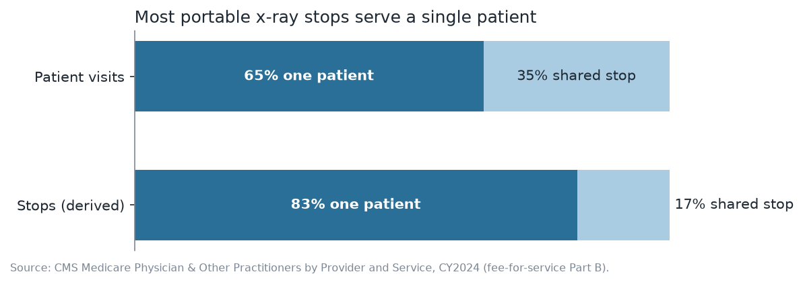
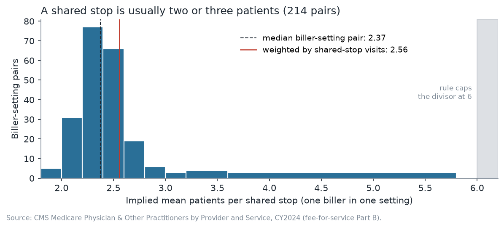
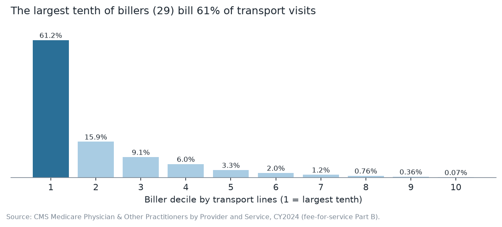

# How mobile x-ray actually runs: three measurements from Medicare billing data

This is a reproducible analysis of a public CMS billing file. It asks how
Medicare's portable x-ray suppliers operate:

- how often a stop serves a single patient;
- how many patients a shared stop serves;
- how concentrated the business is.

Every number comes from public data, and the notebook checks its inputs
before it computes anything.

**Notebook:** [`notebooks/portable-xray-transport.ipynb`](notebooks/portable-xray-transport.ipynb)
(executed, with outputs)

## The question

When an x-ray is taken at a patient's bedside (in a nursing home, an
assisted-living facility or a private home), the supplier bills Medicare for
bringing the equipment. It bills per trip to a location, with one of two
codes:

- **R0070** when one patient is seen there.
- **R0075** for each patient when several are seen at the same stop.

From those two codes:

1. What share of visits, and of stops, serve a single patient?
2. When a stop is shared, how many patients does it serve? The file never
   states it.
3. How concentrated is the billing across suppliers?

## The data

* **Source.** CMS *Medicare Physician & Other Practitioners: by Provider and
  Service*, calendar year 2024, from the data.cms.gov API.
* **Scope.** 875 rows covering the two transport codes plus the set-up code
  Q0092, which is used only as a control. That is 1.1 million transport lines
  from 287 billers (rendering NPIs).
* **What is left out.** No names, addresses or other identifying columns are
  stored, and billers appear as pseudonyms. No table or chart reports the
  share of any single biller. The pseudonyms are a presentation choice, not a
  privacy control: the source file is public, so anyone can rebuild the
  mapping. See [`data/README.md`](data/README.md).

## The method

* **Solo share.** R0070 is one patient at a stop, and R0075 is one line per
  patient at a shared stop. Their ratio is the solo share of *visits*. It is
  also computed per biller and by biller size decile.
* **Stop size, derived from the payment rule.** Medicare pays each
  shared-stop line the single-stop fee divided by the number of patients at
  the stop, capped at six. So for one biller, the ratio of its average
  single-stop allowed amount to its average shared-stop allowed amount is its
  mean number of patients per shared stop. The local fee level cancels within
  the biller.
  * This holds exactly when no stop exceeds six patients and both codes share
    one fee basis. Out-of-band ratios are counted and excluded.
  * The notebook states the algebra, and the case where the divisor counts
    other payers' patients.
  * The derivation is tested on synthetic stops before it is applied.
* **Concentration.** Lines are summed per biller, ranked and reported by
  decile. The largest single biller's share is not reported.
* **Controls.** Seven checks run first: row and line totals, a known row,
  CMS's suppression floor, one transport line per patient per day, and the
  biller count. Each finding then asserts its own accounting, and a failure
  stops the notebook:
  * the settings sum to the total and the deciles hold every biller;
  * every pair is either used or excluded;
  * the stop-size bands cover every shared-stop line;
  * the concentration deciles sum to 100%.

## The answer

| | finding |
|---|---|
| **1** | **65%** of patient visits with a transport line are a stop with a single patient. Counted as stops, the share is about **83%**, five in six. The largest tenth of billers bill 58.5% of their visits as solo stops, and every other decile is above 70%. The median biller is at 82%. |
| **2** | A shared stop serves **2.6 patients** on average, weighted by visits. The median biller-setting pair is at 2.37; 214 of 216 pairs fall inside the bounds the rule allows. Billers whose *average* stop is near the six-patient cap hold under 1% of shared-stop visits. |
| **3** | The largest tenth of billers (29) bill **61%** of transport visits, and the top ten bill 40%. The median biller billed **977** visits in the year. Half of all billers together hold under 5% of the volume. |





Small cells: figure 2 merges any bin of one or two biller-setting pairs into its neighbours, so every bar holds at least three. The outputs also drop `lines_high`, because in the top decile it is the largest biller's count.

**Limitations.** These travel with every finding and are spelled out in the
notebook:

* Medicare fee-for-service Part B only.
* Billers with fewer than 11 beneficiaries on a code are suppressed by CMS.
* Part A nursing-home stays bundle transport and never appear.
* The setting flag cannot separate a private home from a nursing facility.
* A rendering NPI is not a company.
* A stop is a trip to one location, not a van run.
* Stop size is a derivation from allowed amounts, not a count of stops.

## Reproduce it

```
python -m venv .venv
source .venv/bin/activate            # Windows: .venv\Scripts\activate
pip install -r requirements.txt
python -m cms_transport.fetch --check   # re-pull from data.cms.gov and compare with data/
jupyter nbconvert --to notebook --execute --inplace notebooks/portable-xray-transport.ipynb
pytest                                  # the derivation, the controls, the headline figures
```

## Layout

```
notebooks/portable-xray-transport.ipynb   the analysis, executed
src/cms_transport/fetch.py                API pull, column drop, pseudonyms
src/cms_transport/analysis.py             the three analyses and the controls
src/cms_transport/charts.py               one chart per finding
data/cy2024_transport_rows.csv            the 875-row snapshot (see data/README.md)
data/repull-check-2026-10-12.txt          the live re-pull comparison
figures/                                  the three charts
tests/test_analysis.py                    synthetic and regression tests
```

## Licence

The code is MIT-licensed (see [`LICENSE`](LICENSE)). The data in `data/` is a
U.S. Government work published by the Centers for Medicare & Medicaid
Services and is not covered by that licence.

## About

Ehi Eromosele, data analyst and radiologic technology student.
[LinkedIn](https://www.linkedin.com/in/ehieromosele)
